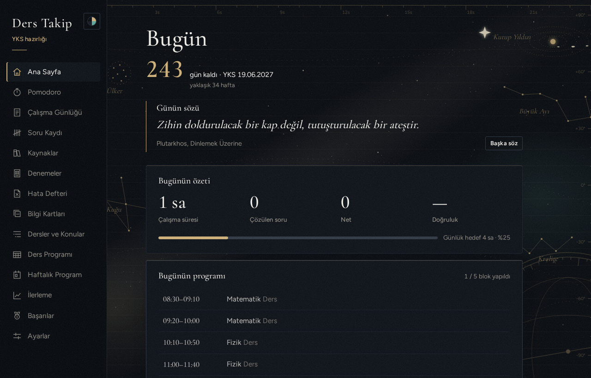
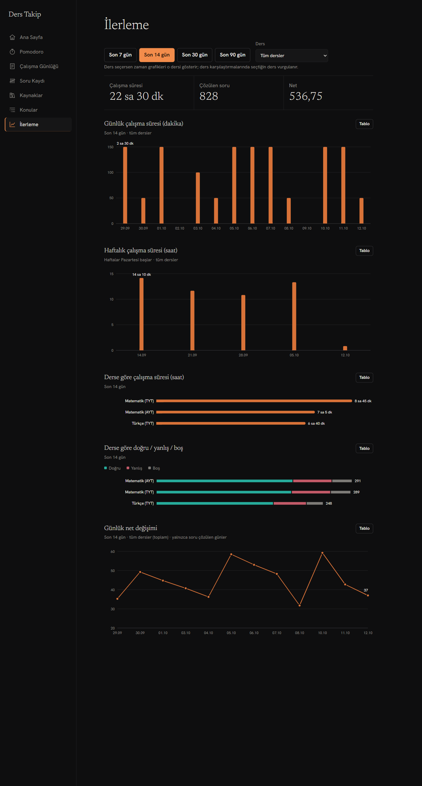
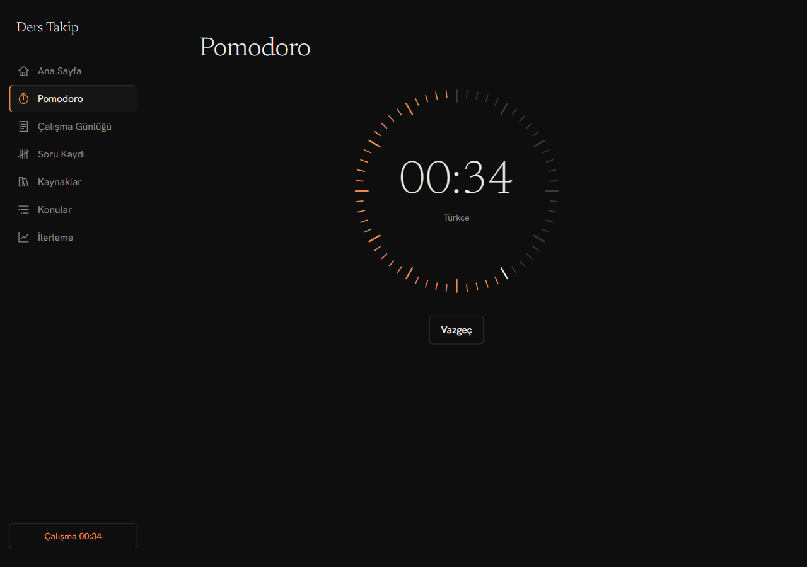
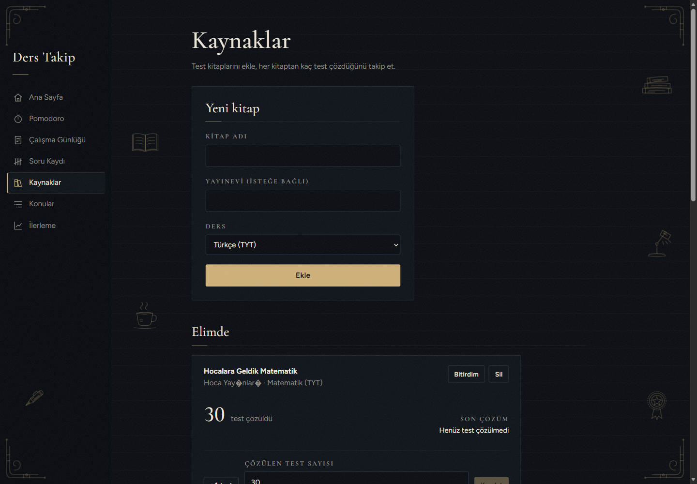
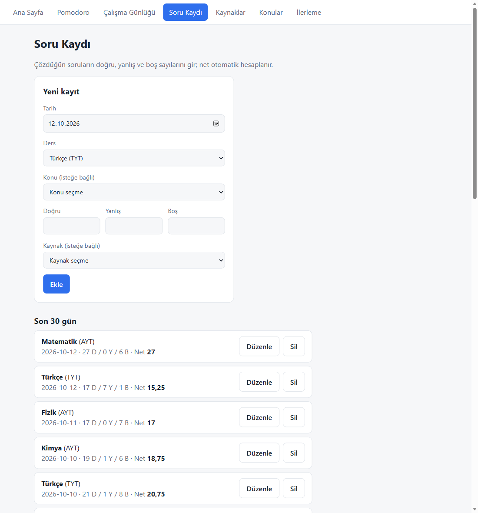
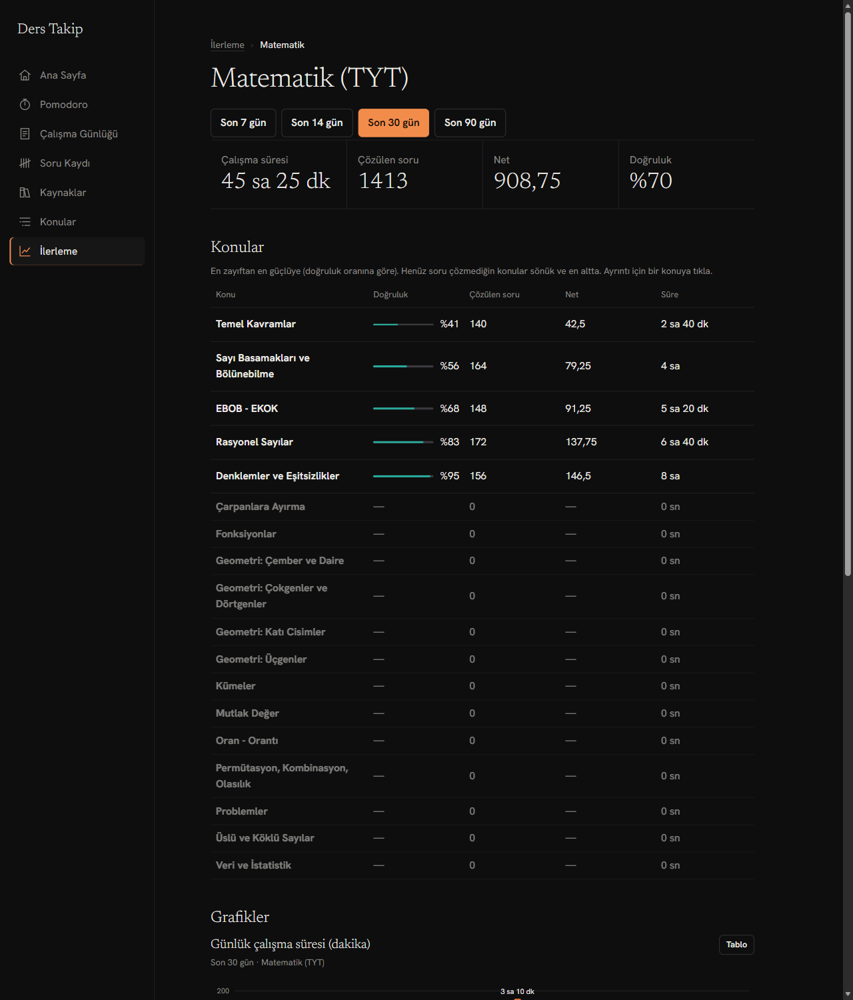
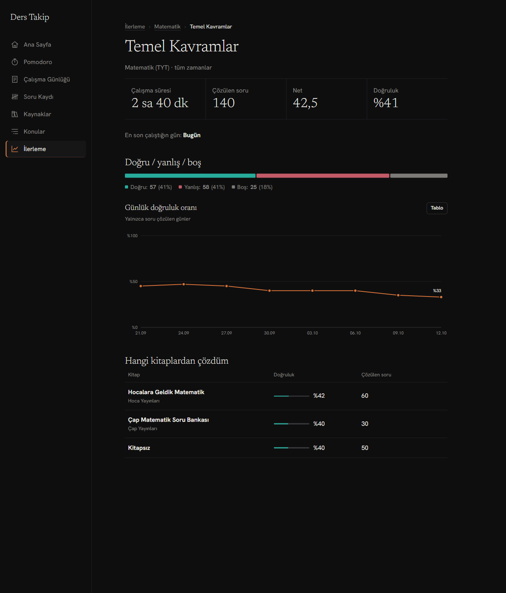
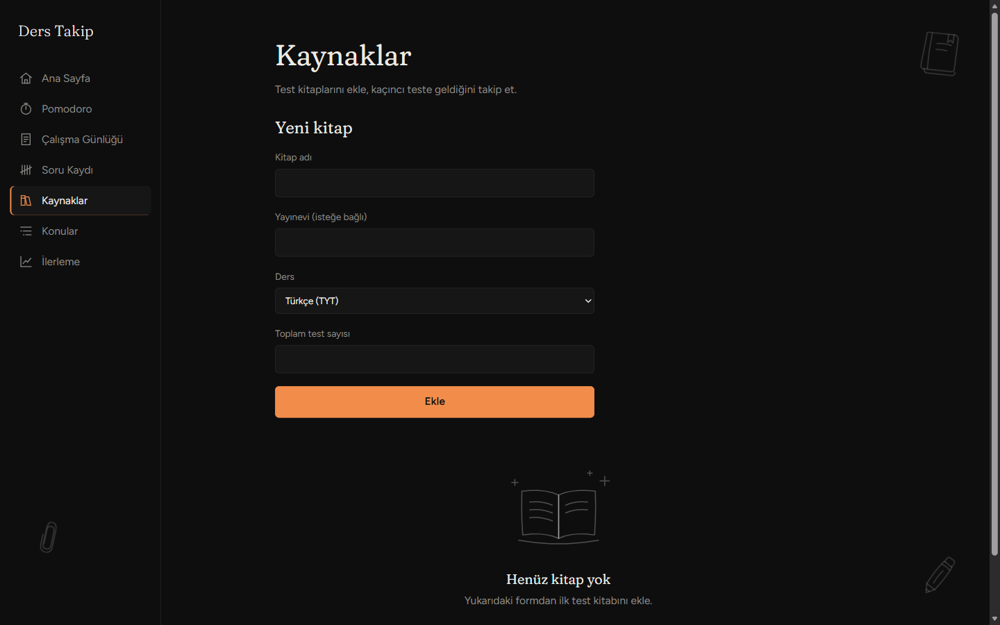

# Ders Çalışma Takip Uygulaması

YKS (sayısal) hazırlığı için kişisel bir çalışma takip uygulaması: Pomodoro ile çalışma süresini kaydet, çözdüğün soruları gir, test kitaplarında kaçıncı teste geldiğini takip et, ilerlemeni grafiklerle gör.

Kendi YKS çalışmam için yaptığım, tek kişilik ve bilgisayarda çalışan bir proje. Uygulama mağazalarında yayınlanmaz; indirip kendi bilgisayarında çalıştırabilirsin. Veriler yalnızca senin bilgisayarındaki tek bir dosyada durur.





## Özellikler

- **Pomodoro:** Ders (ve isteğe bağlı konu) seçip çalışma sayacını başlatırsın. Sayaç, saat çerçevesi gibi 60 çentikli bir kadrandır: süre aktıkça çentikler söner (çalışmada turuncu, molada turkuaz). Süre dolunca çalışma otomatik kaydedilir ve mola başlar. Çalışma/mola süreleri ayarlanabilir (varsayılan 25/5 dk). Sayaç, başka sayfaya geçsen de menüde görünür ve devam eder. "Vazgeç" kayıt oluşturmaz. Kayıt sunucuya ulaşamazsa süre ekranda kalır ve "Tekrar dene" ile kaydedilebilir.
- **Çalışma günlüğü:** Pomodoro kullanmadığın çalışmaları ders, konu, tarih ve dakika girerek elle eklersin. Bugünün kayıtları (Pomodoro ve elle girilenler) toplam süreyle listelenir, istediğini silebilirsin.
- **Soru kaydı:** Tarih, ders, konu ve doğru/yanlış/boş sayılarını girersin (isteğe bağlı olarak hangi kitaptan çözdüğünü seçebilirsin). Net (doğru − yanlış/4) otomatik hesaplanır. Son 30 günün kayıtları listelenir; düzenleyebilir ve silebilirsin.
- **Kaynaklar:** Yalnızca test kitapları: kitap adı, yayınevi ve ders ile eklersin. Her kitap kartında kaç test çözdüğün ("X test çözüldü") ve son çözüm tarihi görünür. "+1 test" düğmesiyle ya da sayıyı yazıp kaydederek sayacı güncellersin; sayı artınca son çözüm tarihi bugüne ayarlanır, kitaba bağlı soru kayıtlarının tarihi de hesaba katılır. Kitap "Elimde" ya da "Bitirdim" durumunda olur. Silerken onay istenir; kitabı silsen de ona bağlı soru kayıtların kaybolmaz.
- **Konular:** İlk kurulumda TYT/AYT ders ve konu listesi hazır gelir. Konular sayfasından her derse konu ekleyebilir, konu adını değiştirebilir ya da silebilirsin. Bir konuyu silsen de ona bağlı çalışma ve soru kayıtların silinmez, sadece konusuz kalır.
- **İlerleme (üç katman):**
  - **Ana sayfa:** Son 7/14/30/90 günü seçip çalışma süresi, çözülen soru, net ve doğruluk oranı özetini görürsün. Altında tüm derslerin listesi ve grafikler (günlük/haftalık çalışma süresi, günlük net, derse göre süre ve doğru/yanlış/boş) var. Bir ders seçersen göstergeler ve zaman grafikleri o dersi gösterir.
  - **Ders sayfası:** Bir derse tıklayınca açılır: o dersin göstergeleri, zaman grafikleri ve konular. Konular **en zayıftan en güçlüye** (doğruluk oranına göre) sıralanır; henüz soru çözmediğin konular sönük ve en altta durur.
  - **Konu sayfası:** Bir konuya tıklayınca açılır: toplam çalışma süresi, çözülen soru, net, doğruluk, doğru/yanlış/boş dağılımı, zaman içinde doğruluk grafiği, hangi kitaplardan çözdüğün ve en son ne zaman çalıştığın.
  - Sayfaların üstünde yol çubuğu (İlerleme › Matematik › Türev) bulunur. Grafiklerin üzerine gelince ayrıntı balonu çıkar; her grafiğin tablo görünümü de vardır.
- **Veri güvenliği (Ayarlar):** Kalıcı depolama izni, yedeği indir/yükle, haftalık yedek hatırlatması ve bilgisayarda seçilen klasöre günlük otomatik yedek (son 14 tutulur). Ayrıntılar aşağıda, "Veriler ve yedekleme" bölümünde.
- **Ana sayfa:** Dört kart: bugünün özeti (süre, soru, net, doğruluk), haftalık değişim (son 7 gün önceki 7 güne göre, ↑ / ↓ yüzde), seri (kaç gündür üst üste çalıştığın) ve günün en çok çalışılan dersi. Altında son 7 günün çalışma ritmi vardır.

| Pomodoro                                                  | Kaynaklar                                                               |
| --------------------------------------------------------- | ----------------------------------------------------------------------- |
|  |  |



| Ders sayfası (konular zayıftan güçlüye)             | Konu sayfası                                        |
| --------------------------------------------------- | --------------------------------------------------- |
|  |  |

## Gereksinimler

- [Node.js](https://nodejs.org) 22 veya üstü

## Kurulum ve çalıştırma

```bash
git clone <bu-deponun-adresi>
cd <klasör>
npm install
npm start
```

`npm start` arayüzü derler ve sunucuyu başlatır. Uygulama `http://localhost:3000` adresinde açılır. Ayarları değiştirmek istersen önce `cp .env.example .env` ile örnek ayar dosyasını kopyala (zorunlu değil).

**Geliştirme modu:** `npm run dev` sunucuyu ve arayüzü birlikte başlatır; arayüz `http://localhost:5173` adresinde açılır ve kodu değiştirdikçe kendiliğinden yenilenir. İki mod da aynı veritabanı dosyasını kullanır.

### Ayarlar (`.env`)

| Değişken  | Açıklama                                                      | Varsayılan        |
| --------- | ------------------------------------------------------------- | ----------------- |
| `PORT`    | Sunucunun portu                                               | `3000`            |
| `DB_PATH` | SQLite dosyasının yolu (göreli yol proje köküne göre çözülür) | `data/calisma.db` |

`.env` dosyası Git'e eklenmez; örnek değerler `.env.example` içindedir.

### Kurulum sorun giderme

Projede bir `.npmrc` dosyası var ve `npm install` sırasında paketlerin kurulum betiklerini kapatıyor. Sebep: `better-sqlite3` derlenmiş dosyaları paketin içinde getirir, ama npm yine de C++ ile derlemeyi denerse (derleme araçları olmayan bilgisayarlarda) kurulum hata verir. Bu dosya sayesinde ek bir araç kurmana gerek kalmaz.

### Veriler ve yedekleme

Veriler tarayıcının kendi deposunda (IndexedDB) durur. Tarayıcı bu depoyu silerse (site verilerinin temizlenmesi, disk dolması) veriler kaybolur; bu yüzden üç önlem vardır. Hepsi **Ayarlar** sayfasındadır:

- **Kalıcı depolama izni:** Uygulama açılışta tarayıcıdan `navigator.storage.persist()` ile kalıcılık ister; verilirse tarayıcı verileri kendiliğinden silmez. İzin durumu Ayarlar'da görünür. Tarayıcı bu izni sorabilir, sessizce verebilir ya da reddedebilir.
- **Yedeği indir / yükle:** Tüm veriyi `yedek-YYYY-AA-GG.json` dosyası olarak indirir; aynı dosyayı yükleyerek geri alırsın (mevcut verinin yerine geçer, geçersiz dosya reddedilir). Son yedek 7 günden eskiyse (ya da hiç yoksa) Ana sayfada hatırlatma çıkar. Telefon gibi her tarayıcıda çalışır.
- **Yedek klasörü (otomatik):** "Yedek klasörü seç" ile bilgisayarında bir klasör seçersin. Uygulama her gün ilk açılışta oraya tarihli bir JSON yedeği yazar, son 14 yedeği tutar ve eskilerini siler (yalnızca `yedek-YYYY-AA-GG.json` adlı dosyalara dokunur). Bu özellik File System Access API ister: **yalnızca Chromium tabanlı masaüstü tarayıcılarda (Chrome, Edge) çalışır**; Firefox ve telefonlarda bölüm gizlenir. Tarayıcı yeni oturumda klasör iznini kendiliğinden vermeyebilir; o zaman Ana sayfada ve Ayarlar'da "Yedeklemeyi sürdür" düğmesi çıkar, tıklayınca yedek yazılır.

İlk kurulumda TYT/AYT ders ve konu listesi otomatik yüklenir.

## Testler

```bash
npm test
```

Sunucu testleri (Vitest + Supertest) her uç için başarılı ve başarısız durumları, gün sınırı gibi riskli yerleri ve net/istatistik hesaplarını kapsar. Arayüz testleri (Vitest) hesap yapan küçük parçaları sınar: Pomodoro süre hesabı ve kadran çentikleri, tarih ve süre biçimlendirme, grafik verisi ve eksen hesapları.

## Tasarım

Hedef his: deri kaplı bir ajanda ve dolma kalem. Gece mavisi-kömür zemin, fildişi yazı ve az kullanılan şampanya altını vurgu (etkin menü öğesi, ana düğmeler, Pomodoro kadranı, ince ayırıcılar).

- **Tipografi:** Başlıklarda zarif **Cormorant Garamond**, metinde okunaklı **Figtree**. Etiketler küçük boyutlu büyük harf ve geniş harf aralığıyla yazılır (gerçek small caps yerine `text-transform` kullanıldı, çünkü yazı tipinin small caps tablosu Türkçe noktalı İ'yi üretmiyor). Tüm sayılar düz ve tabular rakamdır, alt alta düzgün hizalanır. Font dosyaları projeye gömülüdür; uygulama internet olmadan da aynı görünür.
- **Yüzeyler:** Kalın gölge yok; kartlar 1px çizgi kenarlıklı, üstte ince altın ışık çizgisiyle. Bol boşluk, ince ayırıcı çizgiler, başlık altlarında kısa altın çizgi.
- **Doku:** Zeminde çok hafif kâğıt dokusu (grain) ve defter çizgileri.
- **Açık ve koyu tema:** Menüdeki güneş/ay düğmesiyle geçilir. Açık tema krem kâğıt zemin, sepya mürekkep yazı, antik altın (pirinç) ve derin lacivert vurgu, sepya tonlu yumuşak gölgeli kartlar ve sepya gravür motiflerle gelir. Seçim tarayıcıda hatırlanır; kayıt yoksa bilgisayarın sistem temasına uyulur. Tüm renkler CSS değişkenlerindedir (koyu: `index.css`, açık: `theme.css`); yazılar WCAG AA kontrastını geçer.
- **Etkileşim:** Geçişler kısa ve yumuşaktır (0,16 sn), abartılı animasyon yoktur.
- **Grafikler:** Elle çizilmiş SVG, kütüphanesiz. Renkleri (pirinç, deniz yeşili, kiremit) renk körlüğü ve karşıtlık kontrollerinden geçirildi.
- **Motifler:** 13 özel çizim: dolma kalem, kurşun kalem, kitap yığını, açık defter, kum saati, pergel, cetvel, masa lambası, kahve fincanı, ataç, mühür, küre ve mektup zarfı. Hepsi aynı ince çizgi kalınlığında, tek renkte (altın) ve düşük opaklıkta, gravür tarzı tarama çizgileriyle. Dört ekran köşesinde süslemeli köşe ornamentleri vardır. Her sayfa farklı bir motif düzeni alır, stil aynı kalır.
- **Okunabilirlik:** Motifler yalnızca içerik kutusunun dışındaki boş kenar boşluklarında durur; dar ya da kısa ekranlarda gizlenir. Bu, tarayıcıda 390–1920px arası genişlik, 540–1080px arası yükseklik ve tüm sayfalarda ölçülerek doğrulandı (600'den fazla ölçümde veri, form ya da grafiklerle çakışma yok).
- **Boş durumlar:** Henüz kayıt yokken büyük bir çizim ve ne yapılacağını söyleyen kısa bir yönlendirme gösterilir.



Masaüstünde sol menü, telefonda alt sekme çubuğu kullanılır.

## Teknolojiler

| Katman     | Teknoloji                                                             |
| ---------- | --------------------------------------------------------------------- |
| Sunucu     | Node.js + Express                                                     |
| Veritabanı | SQLite ([better-sqlite3](https://github.com/WiseLibs/better-sqlite3)) |
| Arayüz     | React + Vite (React Router, `HashRouter`)                             |
| Grafikler  | Elle çizilmiş SVG (kütüphanesiz)                                      |
| Yazı tipi  | Cormorant Garamond (başlık), Figtree (metin); `@fontsource`, gömülü   |
| Test       | Vitest, Supertest                                                     |

## Proje yapısı

```
server/
  src/
    app.js, server.js     uygulamayı kurar / başlatır
    db.js, seed.js        SQLite şeması ve ilk ders/konu verisi
    validation.js         giriş doğrulama (sunucu her girdiyi kendisi doğrular)
    stats.js              net ve istatistik hesapları
    routes/               sessions, questions, resources, topics, subjects, stats
  tests/
client/
  src/
    pages/                Pomodoro, Çalışma Günlüğü, Soru Kaydı, Kaynaklar, Konular, İlerleme (özet, ders, konu)
    components/, hooks/   ortak parçalar, ikonlar, çizimler (Doodles), Pomodoro kadranı, SVG grafikler
    context/              Pomodoro sayacının durumu
    lib/                  saf yardımcı fonksiyonlar (tarih, süre, grafik verisi, eksen, kadran)
  tests/
docs/                     tasarım belgesi, uygulama planı, ekran görüntüleri
```

## API

Arayüz şu uçları kullanır. Hatalar Türkçe mesajla ve uygun durum koduyla döner (`400` geçersiz girdi, `404` kayıt yok).

| Uç                                             | Açıklama                                                                                             |
| ---------------------------------------------- | ---------------------------------------------------------------------------------------------------- |
| `GET /api/health`                              | Sunucu çalışıyor mu                                                                                  |
| `GET /api/subjects`                            | Dersler, konularıyla birlikte                                                                        |
| `POST /api/topics`                             | Konu ekle (`{ subjectId, name }`)                                                                    |
| `PUT /api/topics/:id`                          | Konuyu yeniden adlandır (`{ name }`)                                                                 |
| `DELETE /api/topics/:id`                       | Konuyu sil                                                                                           |
| `GET /api/sessions?from=&to=`                  | Çalışma kayıtları (tarih aralığı isteğe bağlı, yerel tarihe göre)                                    |
| `POST /api/sessions`                           | Çalışma kaydı ekle (`{ subjectId, topicId, startedAt, durationSeconds, entryType }`)                 |
| `PUT /api/sessions/:id`                        | Kaydı güncelle (tüm alanlar gönderilir)                                                              |
| `DELETE /api/sessions/:id`                     | Kaydı sil                                                                                            |
| `GET /api/resources`                           | Test kitapları (çözülen test sayısı ve son çözüm tarihiyle)                                          |
| `POST /api/resources`                          | Kitap ekle (`{ name, publisher?, subjectId, solvedTests?, status? }`)                                |
| `PUT /api/resources/:id`                       | Kitabı güncelle (`solvedTests` verilmezse mevcut değer korunur; artarsa son çözüm tarihi bugün olur) |
| `DELETE /api/resources/:id`                    | Kaynağı sil                                                                                          |
| `GET /api/questions?from=&to=`                 | Soru kayıtları, net ile birlikte (tarih aralığı isteğe bağlı)                                        |
| `POST /api/questions`                          | Soru kaydı ekle (`{ date, subjectId, topicId?, correct, wrong, blank, resourceId? }`)                |
| `PUT /api/questions/:id`                       | Kaydı güncelle                                                                                       |
| `DELETE /api/questions/:id`                    | Kaydı sil                                                                                            |
| `GET /api/stats/daily?from=&to=&subjectId=`    | Gün gün çalışma süresi, soru sayıları ve net (`from`/`to` zorunlu, `subjectId` isteğe bağlı)         |
| `GET /api/stats/by-subject?from=&to=`          | Ders bazında toplamlar ve doğruluk (8 dersin hepsi, verisiz olanlar sıfırla)                         |
| `GET /api/stats/by-topic?subjectId=&from=&to=` | Bir dersin konu bazında toplamları ve doğruluğu (verisiz konular sıfırla)                            |
| `GET /api/stats/topic/:id`                     | Konunun tüm zamanlardaki özeti: toplamlar, son çalışma günü, kitap kırılımı, günlük doğruluk         |

**Net hesabı:** `net = doğru − yanlış / 4`. Net veritabanında saklanmaz, her seferinde hesaplanır.

**Doğruluk oranı:** `doğru / (doğru + yanlış + boş)`, yüzde olarak yuvarlanır. Hiç soru çözülmemişse `null` döner (sıfır değil, "veri yok" demektir).

**Gün sınırı:** Çalışma kayıtları evrensel saatle (UTC) saklanır, istatistikler ise bilgisayarının yerel saatine göre günlere ayrılır. Gece 00:30'da başlayan çalışma o günün sayılır.

**Sınırlar:** Yazım hatalarının istatistikleri bozmaması için bir çalışma kaydı en fazla 24 saat, soru kaydında doğru/yanlış/boş her biri en fazla 10000, bir kitaptan çözülen test sayısı en fazla 10000 olabilir. Tarihler 2000–2100 yılları arasında olmalıdır.

## Yol haritası

- PDF'ten soru üretme (henüz yapılmadı; ileride eklenecek).

## Nasıl yapıldı?

Proje, önce tasarım ve plan yazılıp sonra küçük adımlarla (her adımda test ve commit) geliştirildi. Tasarım belgesi ve uygulama planı `docs/superpowers/` altında durur.
